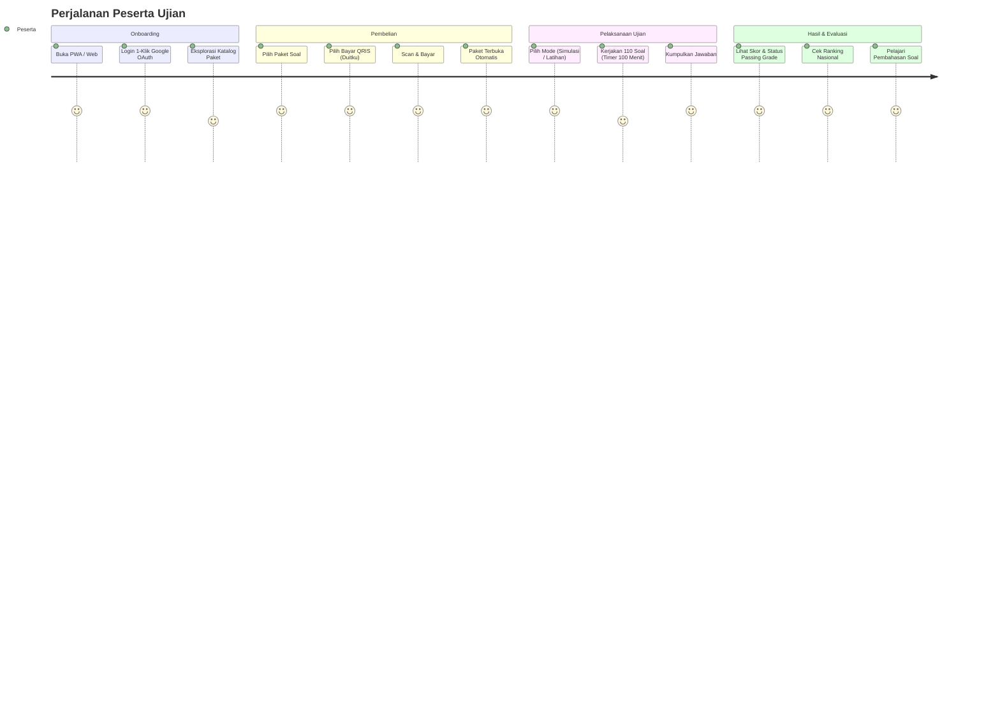
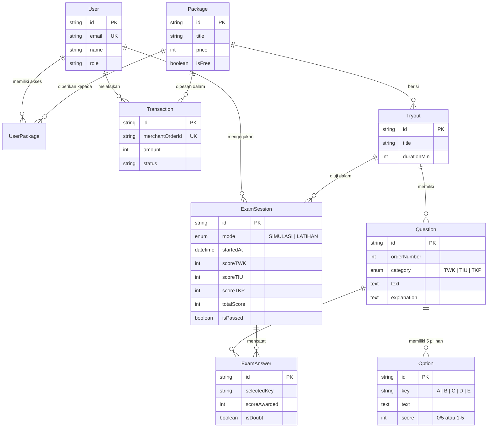
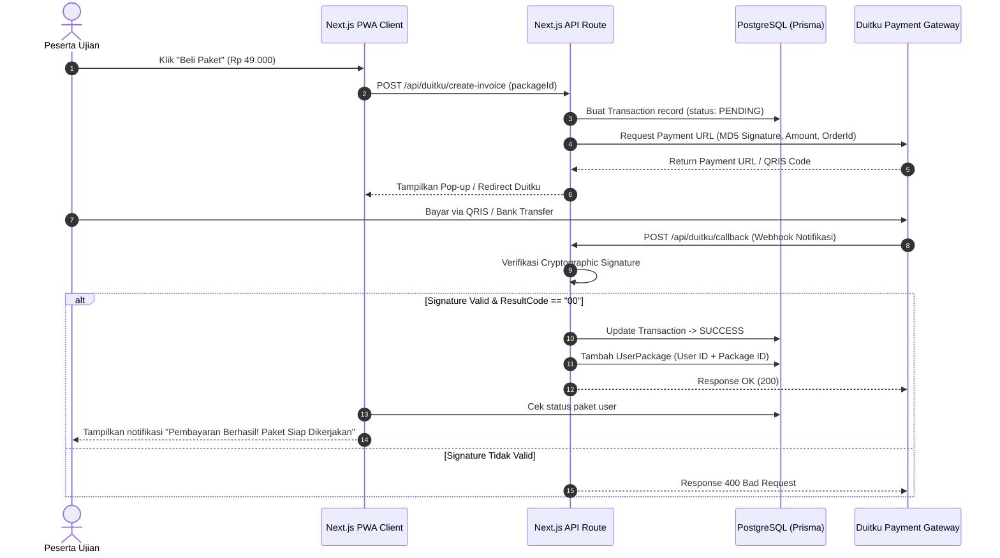
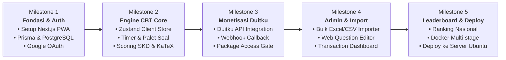

# Product Requirement Document (PRD)
## Platform CBT Tryout SKD CPNS & Kedinasan (SaaS PWA)

- **Product Name:** CAT SKD Platform (Tentative / White-label)
- **Document Version:** 1.0.0
- **Author:** Product & Architecture Team
- **Date:** 2026-11-22
- **Target Launch:** Q1 2027

---

## 1. Executive Summary & Product Vision

### 1.1 Problem Statement
Calon pelamar CPNS dan Sekolah Kedinasan di Indonesia membutuhkan platform simulasi ujian yang:
1. **Representatif:** Mirip 100% dengan sistem CAT BKN resmi (alur, timer, bobot nilai TKP 1-5, dan passing grade).
2. **Fleksibel & Cepat:** Berjalan lancar di perangkat mobile (HP) tanpa lag antar soal dan tahan terhadap koneksi internet yang putus-nyambung.
3. **Pembayaran Transparan:** Banyak peserta tidak menyukai sistem langganan bulanan berulang (*recurring subscription trap*) dan lebih memilih membeli paket soal satuan (*pay-per-package*) sesuai kebutuhan belajar mereka.

### 1.2 Product Vision
Membangun platform SaaS latihan soal dan tryout berbasis PWA (Progressive Web App) yang ringan, modern, berfokus mobile-first, dengan sistem pembayaran sekali bayar (*pay-per-package*) menggunakan gateway lokal Indonesia (Duitku), serta dilengkapi engine simulasi akurat dan bank soal berkualitas tinggi.

---

## 2. Target Persona & User Roles

| Role | Deskripsi | Kebutuhan Utama |
| :--- | :--- | :--- |
| **Peserta Ujian (End-User)** | Pejuang CPNS, Kedinasan, & PPPK yang belajar mandiri melalui smartphone atau laptop. | - Login cepat tanpa ribet password. - Bayar per paket via QRIS/VA instan. - Tampilan ujian responsif 0 ms tanpa reload. - Pembahasan mendalam & ranking nasional. |
| **Super Admin** | Pemilik platform (Owner / Pengelola Konten). | - Dashboard upload soal massal (Excel/CSV). - Pengaturan harga & diskon paket tryout. - Monitoring transaksi pembayaran Duitku real-time. - Analisis performa & statistik kelulusan peserta. |

---

## 3. Business & Monetization Model

### 3.1 Model Transaksi
* **Sistem:** Pay-per-Package (Beli Putus per Paket Soal). **Tidak ada subscription/langganan berulang**.
* **Masa Akses:** Sekali beli, paket dapat diakses selamanya (*Lifetime access per package*) atau hingga periode seleksi selesai.
* **Tiering Produk:**
  1. **Paket Free / Trial:** 1 Paket Mini Tryout (Gratis untuk semua pengguna terdaftar guna memicu konversi).
  2. **Paket Satuan (Single Tryout):** Akses 1 paket simulasi penuh 110 soal (misal: Rp 15.000 – Rp 25.000).
  3. **Paket Bundling (Mastery Bundle):** Akses 5–10 paket tryout sekaligus dengan harga hemat (misal: Rp 49.000 – Rp 99.000).

### 3.2 Payment Gateway Integration (Duitku)
* **Kanal Pembayaran Didukung:**
  * QRIS (Semua E-Wallet: GoPay, OVO, Dana, ShopeePay, LinkAja, BCA Mobile).
  * Virtual Account (BCA, Mandiri, BRI, BNI, Permata, CIMB).
  * Retail (Indomaret / Alfamart).
* **Alur Notifikasi:** Server-to-server webhook callback dengan verifikasi cryptographic signature (MD5).

---

## 4. User Journey & Core Flows

---

## 5. Functional Requirements (FR)

### FR-1: Autentikasi & Akun Pengguna
* **FR-1.1:** Pengguna hanya dapat masuk menggunakan **Google OAuth 1-Klik** (NextAuth.js).
* **FR-1.2:** Sistem otomatis membuat profil pengguna baru saat pertama kali login (Nama, Email, Avatar Google).
* **FR-1.3:** Session management menggunakan JWT terenkripsi dengan masa aktif aman.

### FR-2: Katalog Paket & Manajemen Pembelian
* **FR-2.1:** Menampilkan katalog paket tryout aktif beserta detail jumlah soal, subtes, harga normal, dan harga promo.
* **FR-2.2:** Integrasi Checkout Duitku:
  * Membuat tagihan transaksi (*create invoice*) via API Duitku.
  * Menampilkan pop-up / halaman pembayaran Duitku.
* **FR-2.3:** Webhook Duitku Callback:
  * Menerima notifikasi IPN (*Instant Payment Notification*).
  * Validasi signature `MD5(merchantCode + amount + merchantOrderId + apiKey)`.
  * Status transaksi otomatis berubah ke `SUCCESS` dan akses paket langsung aktif di akun user.

### FR-3: Engine CBT Ujian (Core Exam Player)
* **FR-3.1: Dual Mode Ujian:**
  * **Mode Simulasi Resmi CAT BKN:**
    * Timer mundur ketat **100 menit** untuk 110 soal.
    * Timer tersinkronisasi server (waktu tetap berkurang jika tab ditutup atau browser refresh).
    * Tidak dapat melihat kunci jawaban selama ujian berjalan.
    * Masuk ke dalam kalkulasi **Ranking / Leaderboard Nasional**.
  * **Mode Latihan Santai:**
    * Peserta dapat menjeda (*pause*) ujian dan melanjutkan kapan saja.
    * Tersedia tombol "Lihat Pembahasan" langsung setelah menjawab per butir soal.
    * Tidak mempengaruhi leaderboard kompetitif nasional.
* **FR-3.2: Navigasi & Palet Soal:**
  * Grid nomor 1 s.d. 110 dengan indikator warna status:
    * *Hijau:* Sudah dijawab.
    * *Kuning:* Ragu-ragu.
    * *Putih/Abu:* Belum dijawab.
    * *Border Biru:* Soal aktif yang sedang dibuka.
  * Transisi antar soal instan **0 milidetik** (seluruh data soal disimpan di client-state via Zustand).
* **FR-3.3: Offline Resilience & Autosave:**
  * Setiap perubahan jawaban disimpan seketika ke `IndexedDB / LocalStorage`.
  * Jika koneksi internet terputus di tengah jalan, ujian tetap berjalan normal dan jawaban akan di-sinkronisasi ke server saat koneksi pulih atau saat submit akhir.
* **FR-3.4: Dukungan Rumus Matematika (KaTeX):**
  * Teks soal dan opsi yang memuat sintaks LaTeX (seperti `$\frac{a}{b}$` atau `$x^2$`) dirender secara native, tajam, dan proporsional di HP.

### FR-4: Sistem Penilaian Standar CAT BKN
* **FR-4.1: Aturan Scoring:**
  * **TWK (30 soal):** Benar = +5, Salah/Kosong = 0. Maksimal = 150.
  * **TIU (35 soal):** Benar = +5, Salah/Kosong = 0. Maksimal = 175.
  * **TKP (45 soal):** Skala berbobot 1 s.d. 5 poin per opsi. Kosong = 0. Maksimal = 225.
  * **Total Skor Maksimal:** 550 poin.
* **FR-4.2: Evaluasi Passing Grade Otomatis:**
  * Syarat Lolos SKD Umum:
    * TWK $\ge 65$
    * TIU $\ge 80$
    * TKP $\ge 166$
  * Status kelulusan hanya "LOLOS" jika **ketiga subtes** memenuhi ambang batas nilai tersebut secara simultan.

### FR-5: Leaderboard & Ranking Nasional
* **FR-5.1:** Leaderboard spesifik per paket tryout (hanya peserta yang mengerjakan dalam *Mode Simulasi Resmi*).
* **FR-5.2:** Tampilan peringkat menampilkan: Rank, Nama Peserta (nama disamarkan opsional untuk privasi), Skor TWK, Skor TIU, Skor TKP, Total Skor, dan Status Kelulusan.

### FR-6: Admin CMS & Bank Soal
* **FR-6.1: Bulk Importer Excel/CSV:**
  * Admin dapat mengunggah file `.xlsx` atau `.csv` dengan template standar:
    `[Nomor, Kategori, Soal, Opsi A, Skor A, Opsi B, Skor B, Opsi C, Skor C, Opsi D, Skor D, Opsi E, Skor E, Pembahasan]`.
  * Sistem memvalidasi kelengkapan data sebelum di-commit ke database via Prisma batch transaction.
* **FR-6.2: Manajemen Paket Tryout:**
  * Mengatur nama paket, deskripsi, harga, thumbnail, dan status aktif/nonaktif.
* **FR-6.3: Monitor Transaksi:**
  * Daftar riwayat pembayaran Duitku dengan filter status (Pending, Success, Expired).

---

## 6. Non-Functional Requirements (NFR)

* **NFR-1: PWA (Progressive Web App):**
  * Memenuhi standar Web App Manifest (standalone mode, maskable icons, theme color).
  * Dapat diinstal di layar utama smartphone (Android & iOS) tanpa melalui Play Store / App Store.
* **NFR-2: Performa & Efisiensi:**
  * Initial page load LCP $\le 1.8$ detik.
  * Latensi perpindahan soal: $\le 16$ ms (60 FPS feel).
  * Memory footprint browser $\le 80$ MB selama simulasi 110 soal.
* **NFR-3: Keamanan:**
  * Kunci jawaban soal mode simulasi **tidak boleh dikirim ke browser client** sebelum peserta mengumpulkan ujian (*zero answer leakage*).
  * Webhook Duitku diproteksi validasi MD5 signature dan pencegahan *double-credit transaction*.
* **NFR-4: Portabilitas Hosting:**
  * Seluruh aplikasi dibungkus dalam multi-stage `Dockerfile` standalone sehingga siap dijalankan di VPS Ubuntu mana pun menggunakan Docker Compose yang terhubung ke PostgreSQL lokal.

---

## 7. Arsitektur Data (Entity Relationship Model)

---

## 8. Sequence Diagram: Pembayaran Duitku & Aktivasi Paket

---

## 9. Roadmap Pengembangan & Milestone

---

## 10. Indikator Keberhasilan (KPI)
1. **Checkout Completion Rate:** $\ge 75\%$ transaksi yang dimulai berhasil diselesaikan hingga pembayaran.
2. **CBT Session Reliability:** $0\%$ insiden kehilangan data jawaban peserta saat reload atau gangguan jaringan sementara.
3. **PWA Adoption Rate:** $\ge 40\%$ peserta mobile memasang shortcut PWA di homescreen perangkat mereka.
4. **Passing Grade Clarity:** $100\%$ peserta memahami rincian skor TWK, TIU, dan TKP mereka melalui dashboard hasil ujian.
