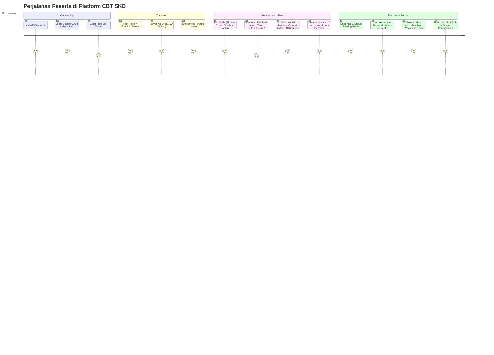
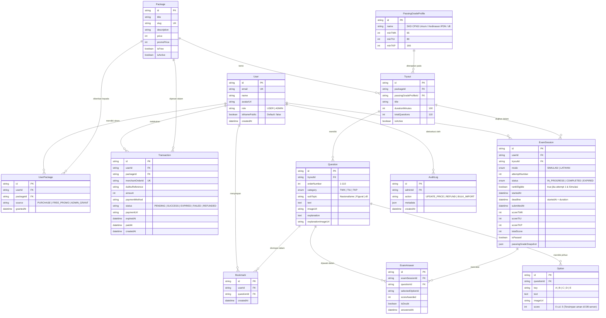
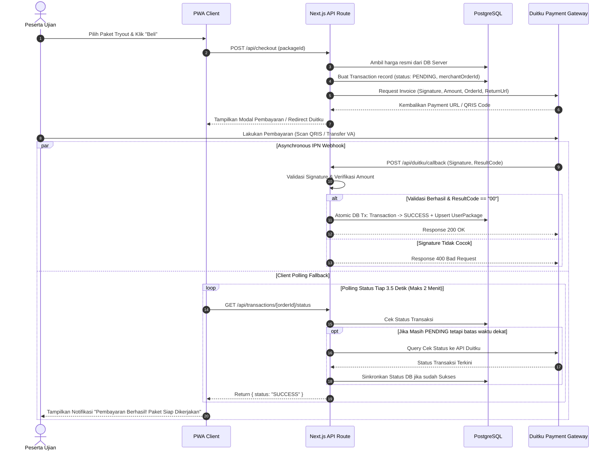
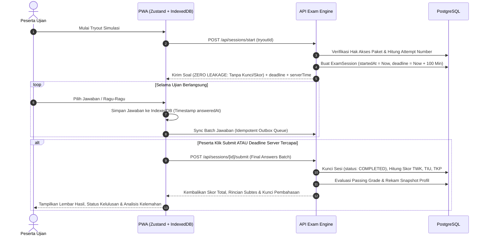
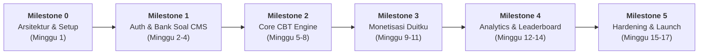

# Product Requirement Document (PRD)
## Platform CBT Tryout SKD CPNS & Kedinasan (SaaS PWA)

| Atribut | Keterangan |
| :--- | :--- |
| **Nama Produk** | CAT SKD Platform (Tentative / White-label Ready) |
| **Versi Dokumen** | **v1.2.0 (Definitive Production-Ready — Konsolidasi ChatGPT, Claude & Gemini)** |
| **Status** | Disetujui untuk Masuk Tahap Development |
| **Author** | Product & Architecture Team |
| **Tanggal Terbit** | 22 November 2026 |
| **Target Launch** | Akhir Q1 / Awal Q2 2027 (±15–17 Minggu Pengembangan) |

> **Panduan Keputusan:** Item bertanda **🔶 KEPUTUSAN** adalah poin strategis yang memerlukan validasi Owner. Setiap item telah dilengkapi **Default Rekomendasi Terpilih** yang aman dan siap langsung diimplementasikan.

---

### Changelog Evolusi Dokumen (v1.0 → v1.1 → v1.2)
* **Penyelarasan Legalitas & Klaim:** Menghapus klaim berisiko *"100% mirip CAT BKN resmi"*, menggantinya dengan *"Simulasi akurat mengikuti format & mekanisme resmi SKD"* disertai klausul Disclaimer Independen (Kritik ChatGPT).
* **Zero Answer Leakage & Keamanan Soal:** Memisahkan data kontrak DTO client vs backend. Opsi jawaban yang dikirim ke browser peserta saat ujian berlangsung **dilarang memuat skor maupun kunci jawaban**.
* **Engine Penilaian Dinamis (`PassingGradeProfile`):** Passing grade dan ambang batas kelulusan tidak di-hardcode, melainkan dikonfigurasi per paket/instansi (mendukung afirmasi Kedinasan & CPNS).
* **Penyempurnaan Integrasi Gateway Duitku:** Menggunakan parameter API v2, pemisahan formula signature transaksi vs callback, penanganan idempotensi ganda, atomic transaction, serta background reconciliation worker.
* **Perbaikan Arsitektur Sync & Offline Resilience:** Menggunakan **IndexedDB** dengan *outbox queue* berbasis timestamp server-authoritative (bukan sekadar `localStorage`), dilengkapi masa toleransi (*grace period*) 5 menit.
* **Fitur Nilai Tambah Pengguna:** Menambahkan *Weakness Analysis* per sub-kategori MenPANRB, fitur *Bookmark Soal*, serta dashboard riwayat latihan.
* **Penyusunan Ulang Roadmap:** Memajukan modul Bank Soal & Admin CMS ke Milestone awal/tengah agar Engine CBT dapat langsung diuji menggunakan bank soal riil.
* **Kepatuhan Regulasi & UU PDP:** Menyediakan fitur penyamaran nama (*pseudonym*) di leaderboard secara default dan hak penghapusan akun/data pribadi (*right to be forgotten*).

---

## 1. Executive Summary & Visi Produk

### 1.1 Problem Statement
Calon pelamar CPNS dan Sekolah Kedinasan di Indonesia menghadapi beberapa kendala utama pada platform latihan yang ada di pasar:
1. **Tidak Representatif:** Banyak platform mengabaikan aturan baku seleksi resmi (seperti pembobotan TKP skala 1–5, evaluasi passing grade simultan, dan aturan *tie-breaker* peringkat yang presisi).
2. **Kinerja Buruk di Ponsel:** Aplikasi terasa lambat, reload setiap pindah soal, dan rawan kehilangan jawaban ketika jaringan internet di daerah tidak stabil.
3. **Jebakan Langganan (*Subscription Trap*):** Peserta enggan berkomitmen pada biaya langganan bulanan berulang ketika mereka hanya butuh berlatih secara intensif menjelang hari ujian.

### 1.2 Product Vision
Membangun platform simulasi CBT (Computer-Based Test) berbasis PWA (Progressive Web App) yang ringan, berfokus *mobile-first*, menggunakan sistem sekali bayar per paket (*pay-per-package*) via gateway lokal (Duitku), dengan simulasi yang presisi, tahan gangguan koneksi, dan analitik evaluasi belajar yang mendalam.

### 1.3 Ruang Lingkup (Scope Boundaries)
| Kategori Seleksi | Status v1.2 | Catatan Implementasi |
| :--- | :---: | :--- |
| **SKD CPNS Umum** | ✅ In Scope | 110 Soal (TWK 30, TIU 35, TKP 45), durasi 100 menit. |
| **SKD Sekolah Kedinasan** | ✅ In Scope | Format sama, passing grade dinamis via `PassingGradeProfile`. |
| **PPPK (Teknis, Manajerial, Soskul, Wawancara)** | ❌ Out of Scope v1 | Format soal dan durasi berbeda total. Masuk backlog v2.0. |
| **SKB / Psikotes / Wawancara Lanjutan** | ❌ Out of Scope | Fokus v1 murni pada penaklukan seleksi tahap pertama (SKD). |

---

## 2. Target Persona & User Roles

| Role | Deskripsi | Kebutuhan Utama |
| :--- | :--- | :--- |
| **Peserta Ujian (End-User)** | Calon peserta seleksi CPNS & Kedinasan yang belajar mandiri melalui smartphone atau laptop. | • Login 1-klik tanpa ribet. • Pembelian instan via QRIS / VA. • Pengerjaan soal instan tanpa reload (< 16 ms). • Jawaban aman saat sinyal drop. • Analisis kelemahan sub-materi & ranking jujur. |
| **Super Admin / Pengelola** | Pemilik platform, pembuat konten soal, dan administrator operasional. | • Impor soal massal via Excel/CSV (mendukung KaTeX & gambar). • Manajemen paket, harga promo, dan passing grade. • Monitoring transaksi Duitku & rekonsiliasi otomatis. • Audit log & statistik analitik butir soal. |

---

## 3. Business & Monetization Model

### 3.1 Model Transaksi (Pay-per-Package)
* **Model:** Sekali bayar per paket soal (*No Recurring Subscription*).
* **Masa Akses:** **🔶 KEPUTUSAN (Default: Lifetime per Paket selama platform beroperasi)**, dilindungi klausul S&K wajar.
* **Struktur Tiering Produk:**
  1. **Paket Free / Trial (Mini Tryout):** 1 paket berisi 30 soal komposit untuk menarik registrasi dan menguji reliabilitas PWA di perangkat pengguna.
  2. **Paket Satuan (Single Tryout):** 1 paket simulasi penuh 110 soal (Rentang harga rekomendasi: Rp 15.000 – Rp 25.000).
  3. **Paket Bundling (Mastery Series):** Paket berisi 5–10 tryout sekaligus dengan diskon menarik (Rentang harga: Rp 49.000 – Rp 99.000).

### 3.2 Unit Economics & Kebijakan Harga
Sebelum menetapkan harga jual paket satuan, wajib memperhitungkan struktur biaya gateway Duitku:
* Fee QRIS (misal: 0.7%) vs Fee Virtual Account (flat Rp 2.500 – Rp 3.500 per transaksi) vs Retail Indomaret/Alfamart (flat Rp 5.000).
* **Aturan Harga Minimum:** Untuk paket satuan harga Rp 15.000, opsi pembayaran Virtual Account atau Retail dapat dibatasi atau dibebankan biaya layanan ke pembeli guna melindungi margin keuntungan bersih (*net profit*).

---

## 4. User Journey & Core Flows

---

## 5. Functional Requirements (FR)

### FR-1: Autentikasi & Manajemen Akun
* **FR-1.1:** Login utama menggunakan **Google OAuth 2.0 1-Klik** via Auth.js (NextAuth).
* **FR-1.2 Deteksi In-App Browser (WebView):**
  * Mendeteksi otomatis jika aplikasi dibuka di dalam in-app browser (Instagram, TikTok, WhatsApp, Telegram) yang memblokir Google OAuth (`disallowed_useragent`).
  * Menampilkan *interstitial warning* ramah: *"Buka tautan ini di Chrome / Safari untuk kemudahan login"*, ATAU
  * **FR-1.3 Fallback Login Magic Link:** Pengguna dapat memasukkan email untuk menerima link login instan satu kali pakai via email.
* **FR-1.4:** Session management menggunakan secure HTTP-only cookie dengan JWT terenkripsi.
* **FR-1.5 Kepatuhan UU PDP (Hak Hapus Data):** Menyediakan fitur di menu profil untuk mengajukan penutupan akun dan penghapusan data pribadi secara permanen.

### FR-2: Katalog Paket, Pembayaran & Entitlement
* **FR-2.1 Katalog Dinamis:** Menampilkan paket aktif, rincian subtes, passing grade rujukan, harga normal, dan label diskon.
* **FR-2.2 Checkout Duitku (Server-Driven Pricing):**
  * Nilai nominal pembayaran (`amount`) **wajib diambil langsung dari database server**, tidak boleh menerima nilai dari client.
  * Server membuat record `Transaction` berstatus `PENDING` dengan `merchantOrderId` unik sebelum meminta invoice ke API Duitku.
* **FR-2.3 Webhook Callback Idempoten (IPN):**
  * Validasi *cryptographic signature* sesuai spesifikasi resmi Duitku.
  * Pencocokan ketat antara `merchantOrderId`, `amount`, dan status hasil transaksi.
  * **Idempotency Guard:** Pemanggilan callback berulang dari gateway tidak boleh menduplikasi hak akses (`UserPackage`). Database transaction wajib menerapkan isolasi atomik dan unique constraint `(userId, packageId)`.
* **FR-2.4 Polling & Rekonsiliasi Otomatis:**
  * Client PWA melakukan polling status berkala (setiap 3–4 detik) dengan batas waktu wajar setelah transaksi dibuat.
  * Background cron job memeriksa transaksi `PENDING` yang melewati batas waktu untuk disinkronkan langsung via API Cek Status Duitku.
* **FR-2.5 Penanganan Refund & Pembatalan:** Status transaksi mendukung siklus hidup: `PENDING`, `SUCCESS`, `EXPIRED`, `FAILED`, dan `REFUNDED`. Admin dapat mencabut akses jika terjadi refund.

### FR-3: Engine CBT Ujian (Core Exam Player)
* **FR-3.1 Dual-Mode Pengerjaan:**
  1. **Mode Simulasi Resmi:**
     * Menggunakan **Server-Authoritative Timer**: Server mencatat `startedAt` dan mengunci `deadline = startedAt + 100 menit`. Timer di client hanya menghitung selisih mundur berdasarkan waktu server.
     * Mengubah jam pada perangkat lokal (HP) tidak berpengaruh terhadap timer ujian.
     * Tab ditutup atau browser refresh tidak menghentikan timer.
     * **Auto-Submit Server:** Jika batas waktu berakhir, sesi otomatis ditutup dan dinilai oleh server.
     * **Aturan Leaderboard:** Hanya pengerjaan pertama (`attemptNumber === 1`) yang berhak masuk ke papan peringkat (*Leaderboard Eligible*). Pengerjaan ulang (jika diizinkan) hanya tersimpan sebagai riwayat pribadi.
  2. **Mode Latihan Mandiri:**
     * Peserta bebas menjeda (*pause*) pengerjaan.
     * Tombol *"Lihat Pembahasan"* dapat dibuka langsung setelah menjawab butir soal bersangkutan.
     * Tidak diikutsertakan dalam kompetisi papan peringkat.
* **FR-3.2 Zero Answer Leakage (Keamanan Kunci Soal):**
  * Payload API soal ujian yang dikirim ke browser peserta pada Mode Simulasi **hanya berisi:** `id`, `orderNumber`, `category`, `text`, `imageUrl`, dan daftar opsi `{ id, key, text, imageUrl }`.
  * **Kunci jawaban benar, bobot nilai TKP (1–5), dan teks pembahasan dilarang keras dikirim ke browser** sebelum peserta resmi mengumpulkan lembar ujian (*submit*).
* **FR-3.3 Navigasi & Palet Soal Modern:**
  * Grid nomor 1 s.d. 110 dengan indikator visual:
    * *Hijau:* Sudah dijawab.
    * *Kuning:* Ragu-ragu.
    * *Abu-abu:* Belum dijawab.
    * *Border Aksen:* Soal yang sedang aktif dibuka.
  * Transisi perpindahan soal instan (< 16 ms) tanpa reload, dikelola via client store (Zustand).
  * Palet soal dilengkapi teks/label status selain warna guna mendukung aksesibilitas.
* **FR-3.4 Render Rumus & Dukungan Gambar:**
  * Render formula matematika dan sains tajam menggunakan **KaTeX** native.
  * Dukungan penuh soal dan opsi berbasis media gambar (TIU Figural, tabel grafis) yang responsif pada layar ponsel.
* **FR-3.5 Offline Resilience, IndexedDB Outbox & Grace Period:**
  * Setiap perubahan jawaban disimpan seketika ke **IndexedDB** lokal (dengan fallback aman).
  * Sinkronisasi jawaban ke server dilakukan secara batch di latar belakang menggunakan *idempotent sync queue* `(sessionId, questionId)`.
  * **Grace Period Sync (5 Menit):** Jika koneksi terputus saat detik-detik akhir ujian (menit ke-100), server memberikan toleransi penerimaan paket jawaban tertunda hingga menit ke-105, asalkan timestamp lokal perubahan jawaban (`answeredAt`) terbukti terjadi sebelum `deadline` resmi.
* **FR-3.6 Integritas & Deteksi Kecurangan Dasar:**
  * 1 akun hanya boleh memiliki 1 sesi ujian aktif bersamaan.
  * Pencatatan event perpindahan fokus tab / jendela browser sebagai log audit integritas.

### FR-4: Sistem Penilaian Standar CAT BKN & Passing Grade Dinamis
* **FR-4.1 Perhitungan Skor di Server:**
  * **TWK (30 soal):** Benar = +5, Salah/Kosong = 0 (Skor maks: 150).
  * **TIU (35 soal):** Benar = +5, Salah/Kosong = 0 (Skor maks: 175).
  * **TKP (45 soal):** Bobot bertingkat 1 s.d. 5 per opsi, Kosong = 0 (Skor maks: 225).
  * **Total Skor Maksimal:** 550.
* **FR-4.2 Evaluasi Passing Grade Terisolasi (`PassingGradeProfile`):**
  * Ambang batas tidak di-hardcode di kode program.
  * Pengaturan disimpan di entitas `PassingGradeProfile` (contoh default SKD CPNS Umum: TWK $\ge 65$, TIU $\ge 80$, TKP $\ge 166$).
  * Status kelulusan hanya "LOLOS" jika ketiga subtes memenuhi ambang batas profil secara bersamaan.
  * Hasil ujian merekam snapshot profil passing grade yang berlaku pada saat pengerjaan agar data historis tetap valid meski regulasi berubah di kemudian hari.

### FR-5: Leaderboard Platform & Aturan Tie-Breaker BKN
* **FR-5.1:** Papan peringkat menampilkan peserta Mode Simulasi Resmi yang menyelesaikan ujian pada percobaan pertama (`attemptNumber === 1`).
* **FR-5.2 Aturan Tie-Breaker Resmi BKN:**
  Jika terdapat peserta dengan **Total Skor yang sama**, penentuan urutan peringkat diurutkan secara hierarkis:
  1. Skor **TKP** lebih tinggi.
  2. Jika TKP sama, Skor **TIU** lebih tinggi.
  3. Jika TIU sama, Skor **TWK** lebih tinggi.
  4. Jika seluruh skor sama, peserta dengan **Waktu Penyelesaian Tercepat** menempati posisi lebih tinggi.
* **FR-5.3 Privasi Pengguna (UU PDP):**
  * Secara default, nama peserta ditampilkan dalam bentuk inisial / nama samaran (contoh: *Budi S. / Pejuang_082*).
  * Peserta memiliki opsi sukarela (*opt-in*) di pengaturan profil untuk menampilkan nama lengkap di papan peringkat publik.

### FR-6: Analisis Evaluasi Belajar (Learning Analytics & Weakness Radar)
* **FR-6.1 Pemetaan Sub-Topik Kisi-Kisi Resmi MenPANRB:**
  * Setiap soal memiliki metadata sub-kategori:
    * **TWK:** Nasionalisme, Integritas, Bela Negara, Pilar Negara, Bahasa Indonesia.
    * **TIU:** Kemampuan Verbal (Analogi, Silogisme, Analitis), Kemampuan Numerik (Berhitung, Deret, Kuantitatif, Cerita), Kemampuan Figural (Analogi, Ketidaksamaan, Serial).
    * **TKP:** Pelayanan Publik, Jejaring Kerja, Sosial Budaya, TIK, Profesionalisme, Anti Radikalisme.
* **FR-6.2 Radar Kelemahan (*Weakness Analysis*):**
  * Grafik visualisasi persentase penguasaan materi per sub-topik.
  * Rekomendasi materi belajar yang mendesak untuk diperbaiki berdasarkan tingkat kesalahan tertinggi.
* **FR-6.3 Bookmark & Review Pembahasan:**
  * Peserta dapat menandai butir soal sulit ke daftar *Bookmark*.
  * Halaman review pembahasan menyajikan penjelasan logis dan trik cepat pengerjaan per nomor.

### FR-7: Admin CMS & Bank Soal
* **FR-7.1 Bulk Importer Cerdas (Excel/CSV):**
  * Format impor standar:
    `[Nomor, Kategori, SubTopik, Soal, Soal_ImageUrl, Opsi A, Skor A, Opsi B, Skor B, Opsi C, Skor C, Opsi D, Skor D, Opsi E, Skor E, Pembahasan, Pembahasan_ImageUrl]`.
  * Parser validasi otomatis sebelum commit: deteksi rumus KaTeX rusak, pengecekan kelengkapan 5 opsi, kepastian bobot TKP 1–5 lengkap, dan validasi jumlah komposisi soal (30-35-45).
  * Tampilan *preview* kesalahan per nomor baris sebelum disimpan ke database.
* **FR-7.2 Manajemen Media Soal:**
  * Dukungan unggah gambar langsung atau via folder ZIP berindeks nama soal ke Object Storage (S3 / R2 / MinIO).
* **FR-7.3 Manajemen Paket & Profil Passing Grade:**
  * Buat paket baru, atur thumbnail, tautkan profil passing grade, tentukan harga normal & harga promo.
* **FR-7.4 Financial Monitor & Audit Log:**
  * Dashboard status pembayaran real-time dengan filter (`PENDING`, `SUCCESS`, `EXPIRED`, `REFUNDED`).
  * Pencatatan log aktivitas admin (*Audit Trail*) untuk perubahan harga, penerbitan soal, atau pengembalian dana (*refund*).

---

## 6. Non-Functional Requirements (NFR)

* **NFR-1 Standar PWA (Progressive Web App):**
  * Web App Manifest lengkap (`display: standalone`, `theme_color`, maskable icons).
  * Cache First untuk aset statis dan App Shell; Network First dengan IndexedDB fallback untuk API sesi ujian.
* **NFR-2 Performa & Kecepatan:**
  * Largest Contentful Paint (LCP) $\le 1.8$ detik pada koneksi 4G.
  * Latensi pergantian soal di client $\le 16$ ms (animasi 60 FPS tanpa jank).
  * Penggunaan memori browser $\le 80$ MB pada perangkat Android kelas *entry-level*.
* **NFR-3 Skalabilitas & Beban Puncak (Tryout Akbar):**
  * Target kapasitas awal: Mampu melayani **1.000 peserta aktif bersamaan (*concurrent users*)** saat tryout serentak tanpa degradasi performa.
  * Sinkronisasi jawaban dikirim dalam format batch berkala (bukan HTTP request per satu klik tombol) guna menghemat koneksi PostgreSQL.
  * Connection pooling database dan caching leaderboard via in-memory/Redis.
* **NFR-4 Keamanan & Integritas Data:**
  * Enkripsi data transaksi dan verifikasi signature gateway yang ketat.
  * Penerapan rate-limiting pada endpoint autentikasi, checkout, dan submit jawaban.
  * Pengamanan rahasia credential (API keys, OAuth client secret) murni pada environment server.
* **NFR-5 Reliabilitas & Pemulihan Bencana (Disaster Recovery):**
  * Backup database PostgreSQL otomatis harian ke penyimpanan off-site di luar VPS.
  * Target RPO (*Recovery Point Objective*) $\le 24$ jam; RTO (*Recovery Time Objective*) $\le 4$ jam.
* **NFR-6 Observabilitas & Monitoring:**
  * Pelacakan error real-time menggunakan Sentry.
  * Alerting instan ke Telegram/Email jika terjadi lonjakan kegagalan callback Duitku atau error submit ujian.
* **NFR-7 Aksesibilitas:**
  * Ukuran target sentuh tombol $\ge 44 \times 44$ px untuk kenyamanan navigasi jempol di ponsel.
  * Kontras warna memenuhi standar WCAG 2.2 AA.

---

## 7. Arsitektur Data (Entity Relationship Model)

---

## 8. Sequence Diagrams

### 8.1 Alur Transaksi Duitku & Aktivasi Idempoten

### 8.2 Siklus Hidup Pengerjaan Ujian Simulasi

---

## 9. Kebijakan Legalitas & Kepatuhan Regulasi

1. **Disclaimer Resmi (Penafian Kemitraan):**
   * Platform wajib mencantumkan disclaimer pada *footer* web dan lembar hasil ujian:
     > *"Platform ini merupakan sarana simulasi belajar independen dan tidak terafiliasi secara resmi dengan Badan Kepegawaian Negara (BKN) maupun Kementerian PANRB. Nilai tryout adalah hasil simulasi dan tidak menjamin kelulusan pada seleksi resmi pemerintah."*
2. **Kepatuhan Hak Cipta Soal:**
   * Soal-soal yang diunggah harus hasil karya tim internal atau berlisensi sah.
   * Disediakan form laporan sanggahan konten (*content takedown*) jika terdapat materi yang melanggar hak cipta pihak ketiga.
3. **Dokumen Legal Sebelum Rilis Publik:**
   * Halaman resmi *Syarat & Ketentuan Layanan (Terms of Service)*.
   * Kebijakan Privasi *(Privacy Policy)* sesuai standar Undang-Undang Perlindungan Data Pribadi (UU PDP).
   * Kebijakan Pengembalian Dana *(Refund Policy)* yang menegaskan bahwa paket tryout yang telah diakses/dikerjakan tidak dapat di-refund, kecuali terjadi insiden *double-debiting* teknis dari gateway.

---

## 10. Roadmap Pelaksanaan Proyek (15–17 Minggu)

Urutan implementasi diselaraskan dengan kebutuhan teknis (Bank Soal & CMS dimajukan agar CBT Engine dapat dites dengan soal nyata):

| Milestone | Ruang Lingkup Pengerjaan | Durasi | Output Kunci |
| :--- | :--- | :---: | :--- |
| **M0 – Fondasi** | Setup Next.js PWA, Prisma, PostgreSQL Docker, arsitektur folder. | 1 Minggu | Repositori & boilerplate siap kerja. |
| **M1 – Auth & CMS** | Google OAuth, WebView Fallback, Bulk Importer Excel/CSV, manajemen soal & gambar. | 3 Minggu | Admin dapat mengimpor 110 soal utuh beserta kunci & gambar. |
| **M2 – CBT Engine** | Server timer, IndexedDB outbox, transisi < 16ms, KaTeX, scoring server, passing grade dinamis. | 4 Minggu | Engine ujian dapat dikerjakan secara offline-resilient & dinilai akurat. |
| **M3 – Monetisasi** | Integrasi API Duitku, webhook callback idempoten, polling, rekonsiliasi transaksi, access gate. | 3 Minggu | Alur beli via QRIS/VA berhasil dan paket otomatis aktif. |
| **M4 – Analitik** | Leaderboard (Tie-Breaker BKN), Weakness Analysis MenPANRB, Bookmark soal, review pembahasan. | 3 Minggu | Peserta mendapatkan laporan hasil mendalam & peringkat nasional. |
| **M5 – Rilis** | Load test 1.000 user, optimasi PWA, Sentry APM, backup otomatis, beta tertutup & live VPS. | 3 Minggu | Platform live di domain publik dengan performa stabil. |

---

## 11. Indikator Keberhasilan (KPI Target)

### 11.1 KPI Teknis & Produk
* **CBT Session Reliability:** $\ge 99.9\%$ sesi yang terganggu koneksi berhasil dipulihkan tanpa kehilangan jawaban.
* **Payment Auto-Activation Rate:** $\ge 99.0\%$ transaksi sukses teraktivasi otomatis ke akun dalam waktu $< 30$ detik.
* **Performa Navigasi Soal:** $\le 16$ ms latensi antar soal di perangkat ponsel.
* **PWA Install Rate:** $\ge 35\%$ pengguna seluler memasang PWA ke homescreen.

### 11.2 KPI Bisnis
* **Conversion Rate (Free ke Berbayar):** $\ge 7\% – 10\%$ peserta mini tryout membeli paket berbayar pertama mereka.
* **Repeat Purchase Rate:** $\ge 25\%$ pembeli paket satuan kembali membeli paket lainnya atau paket bundling.
* **Net Transaction Margin:** Mempertahankan margin bersih per transaksi satuan $\ge 80\%$ setelah dikurangi fee Duitku & beban server.

---

## 12. Matriks Keputusan Strategis (🔶 KEPUTUSAN)

| No | Poin Keputusan | Opsi Pilihan | **Rekomendasi Terpilih (Default)** | Alasan |
| :-: | :--- | :--- | :--- | :--- |
| **1** | **Masa Akses Paket** | A) Lifetime per paket B) Berakhir saat periode SKD tahunan selesai | **Opsi A: Lifetime per Paket** | Meningkatkan nilai jual (*perceived value*) produk dan memicu kepuasan calon peserta. Dilindungi klausul S&K penghentian wajar. |
| **2** | **Percobaan Ujian Simulasi** | A) 1x simulasi saja B) Boleh retake berkali-kali, tapi hanya attempt 1 masuk ranking | **Opsi B: Retake diizinkan, Attempt 1 masuk Ranking** | Memberikan nilai edukasi maksimal untuk belajar mandiri tanpa merusak integritas leaderboard kompetitif. |
| **3** | **Fallback Login WebView** | A) Hanya peringatan buka Chrome B) Peringatan + Magic Link Email | **Opsi B: Peringatan + Magic Link Email** | Mencegah drop-off calon pembeli yang mengeklik iklan dari Instagram/TikTok. |
| **4** | **Penyimpanan Gambar Soal** | A) VPS Local Disk B) S3 Compatible / Cloudflare R2 | **Opsi B: Cloudflare R2 / S3 Storage** | Mencegah beban bandwidth pada VPS utama dan biaya egress gratis/sangat murah. |
| **5** | **Batas Harga Minimum Satuan** | A) Rp 10.000 B) Rp 15.000 – Rp 20.000 | **Opsi B: Rp 15.000 – Rp 20.000** | Menjaga margin bisnis agar tidak tergerus oleh fixed fee Virtual Account Duitku (±Rp 3.000). |
| **6** | **Target Waktu Peluncuran** | A) Akhir Q1 2027 B) Awal Q2 2027 | **Opsi B: Awal Q2 2027** | Jadwal paling realistis untuk pengerjaan terukur dengan uji beban menyeluruh. |

---

## 13. Matriks Risiko & Mitigasi

| Risiko Potensial | Tingkat Dampak | Rencana Mitigasi Teknis & Operasional |
| :--- | :---: | :--- |
| **Lonjakan Beban Server saat Tryout Akbar** | Tinggi | Terapkan *batch synchronization* jawaban (kirim per 15-30 detik atau saat navigasi jeda), indeks query PostgreSQL `(sessionId, questionId)`, dan caching hasil leaderboard. |
| **Kehilangan Data Lokal di iOS Safari** | Sedang | Tampilkan anjuran instalasi PWA di layar awal, percepat frekuensi sinkronisasi background ke server untuk pengguna perangkat Apple iOS. |
| **Keterlambatan Callback Payment Gateway** | Tinggi | Sediakan tombol manual *"Cek Status Pembayaran"* di frontend yang memicu query verifikasi status langsung ke API Duitku, serta background job rekonsiliasi. |
| **Kebocoran Kunci Jawaban di Browser** | Kritis | Terapkan aturan ketat *Zero Answer Leakage*: DTO soal untuk client sama sekali tidak menyertakan kunci jawaban dan bobot nilai TKP. Seluruh scoring dilakukan di backend. |
| **Komplain Nilai Akibat Format Soal Berubah** | Sedang | Gunakan `PassingGradeProfile` dinamis yang dapat disesuaikan admin sewaktu-waktu sesuai KepmenPANRB terbaru tanpa perlu mengubah struktur kode program. |
